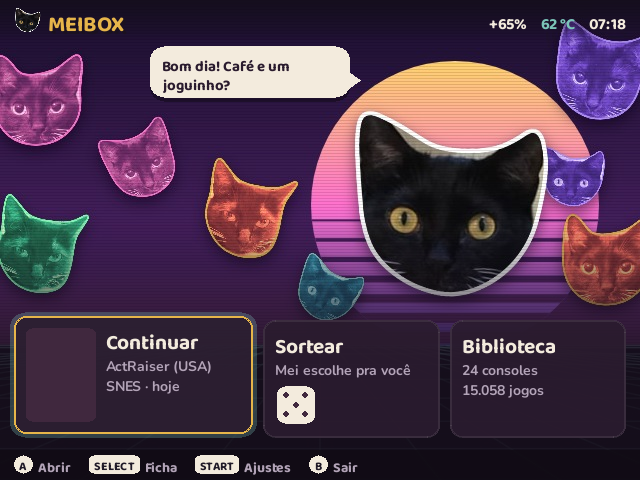
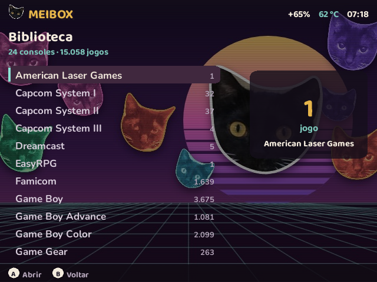
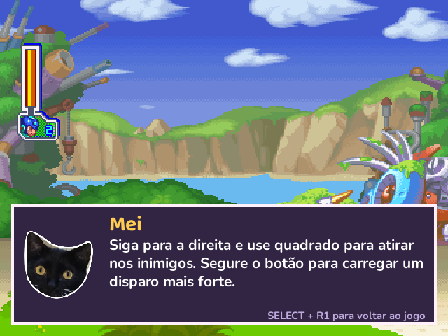
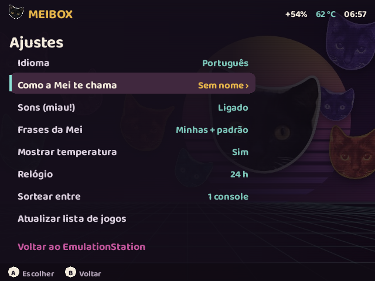
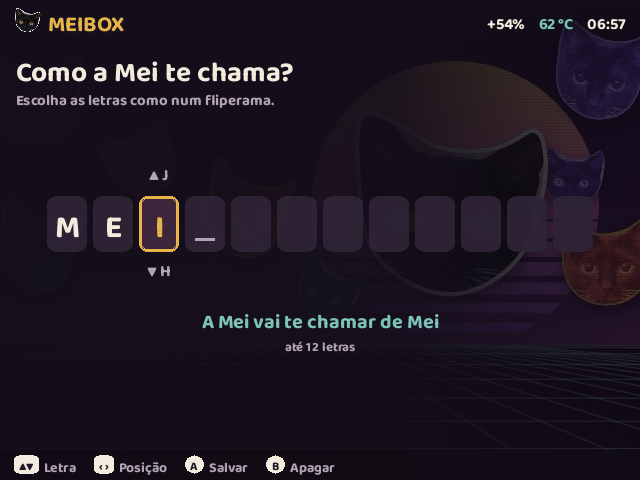
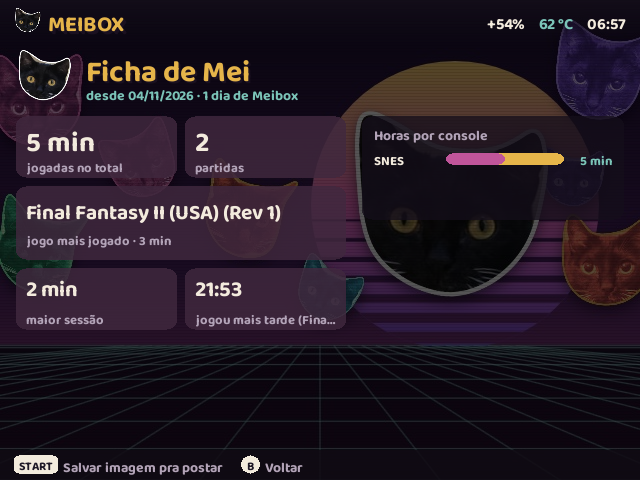

# Meibox

*[Leia em português](README.md)*

A cozy home screen and an in-game AI helper for the **R36S** handheld (and clones running ArkOS / dArkOS), starring **Mei**, a real black-and-white cat.

The main parts are two programs that work on their own or together. The installer also makes your games **[run faster](#faster-games)**, and there is a diagnostics tool [below](#more-in-this-repository).

| Folder | What it is |
|---|---|
| [`meibox/`](meibox/) | **Meibox**, a game launcher that opens before EmulationStation. It has a welcome screen with "continue", a random pick by Mei, a fast library, your play stats ("Ficha") and settings in Portuguese or English. |
| [`copiloto/`](copiloto/) | **Copiloto da Mei**, an in-game hint helper. Press **SELECT + R1** in any RetroArch game: the game pauses and Mei's speech balloon tells you what to do right now, based on a screenshot. Press it again to keep playing. |

  
  
  
  
  
  

## Faster games

The installer asks whether to make your games run faster (recommended). Behind it are two days of measurements on an R36S: each game was measured from the same heavy scene before and after every change, and every change can be undone.

- **No game stutters:** of the 27 heaviest games measured, the ones that could not hold 60 fps went from **5 to 0**.
- **SNES:** **24% faster** on average. Star Fox went from 63 to 96 fps, and Doom from 58 to 79.
- **GBA:** 11% to 16% faster in any game, and **55% to 280%** faster in the heavy 3D ones. F-Zero GP Legend went from 70 to 268 fps.
- **Quicker button:** almost every SNES, GBA and Mega Drive game responds **one frame sooner** (~16 ms).

How it was done:
- **Rebuilt emulators:** snes9x, mGBA and gpSP were compiled for the R36S processor. For snes9x and mGBA, the build was guided by a profile recorded while playing on the device itself.
- **Video tuned per game:** light games run without the extra video delay, and heavy ones get headroom.
- **The right emulator for each game:** the games that need it use a different emulator, such as Star Fox and the other Super FX games, Doom and the 3D GBA games.

The installer recognises games by their ROM content, not by file name, so it works with your collection, translations included. If a new emulator does not load on your system, the original stays. Remove puts everything back. The method and every number are in the [report](desempenho/results/RELATORIO-FINAL.md) (in Portuguese).

The code, comments and Mei's lines are mostly in Brazilian Portuguese. The interface and the hints also come in English.

## Requirements

- An R36S or similar handheld with **dArkOS** or **ArkOS**. Tested on dArkOSRE.
- It does not work on ROCKNIX, AmberELEC or Knulli, which are built differently.
- For the copilot, which is optional:
  - a USB Wi-Fi adapter, because the R36S has no Wi-Fi;
  - an OpenAI or Anthropic API key.

## Install

No Wi-Fi, terminal or cable needed: just the SD card.

1. Download `Meibox-<version>.zip` from [Releases](https://github.com/carbiecarbie/meibox/releases) and unzip it.
2. Switch the device off, take out the system SD card and put it in your computer. Open the **EASYROMS** drive (where the games are).
3. Copy the `tools` and `totobox` folders from the ZIP into EASYROMS. If the computer asks, merge or replace.
4. *(Optional, for the copilot)* open `EASYROMS/totobox/chave-da-ia.txt`, paste your key on the empty line and save.
5. Put the card back, switch on and open **Options › Tools › Instalar Meibox**. Pick English and follow the screen. At the end it restarts, and Meibox opens.

- **Update:** copy the new version's folders over the old ones and run the same item.
- **Remove:** run the same item and choose Remove.
- **Skip Meibox once:** hold **B** while the device starts.

**Want an AI to do it?** If you use an assistant that works on your computer (Claude Code, Codex and the like), connect the device to Wi-Fi and ask it to read `PARA-SUA-IA.md` from the ZIP. It installs over the network, explains each step and never sees your key.

Prefer the terminal, want a different AI, or working on the code? See the [manual install and advanced options](docs/manual-install.md).

## Using Meibox

- **Welcome screen:** left/right and A pick a card, START opens settings, SELECT opens your stats, B goes back to EmulationStation.
- **Settings › What Mei calls you:** pick up to 12 letters, arcade style. Up/down change the letter, left/right move, A saves and B erases. Mei and the copilot then use this name.
- **Your own lines:** write them for Mei in `totobox/frases-en.txt` (or `frases-pt.txt`) on the card. The file explains the format.
- **Stats image:** START on the stats screen saves a picture to post, to `totobox/fichas/`. To add a footer to it, such as your site, write it on the first line of `totobox/rodape-ficha.txt`.

## Mei Copilot

In a RetroArch game, press **SELECT + R1**. The game pauses, the screenshot goes to the AI you chose, and Mei answers in a balloon over the game.

- **Game guide:** the first time you ask for help in a game, Mei **researches that game on the web**. This takes about 1 minute, and the screen shows "Mei está estudando…". She writes a guide to `totobox/guias/<Console>/<Game>.txt` with:
  - controls for that version;
  - levels;
  - the 5 places where players get stuck most;
  - bosses;
  - missable items;
  - secrets.

  Every later hint uses it. You can read and edit it from a PC, or delete it to have it redone.
- **Journal:** a short log per game, so Mei doesn't repeat herself.
- **Saved hints:** each hint is also saved as an image (game screen + balloon) in `totobox/dicas/`, ready to post.
- **Limits:** 200 hints and 10 guides per day. A failed hint doesn't count.
- **Language and name:** they follow Meibox's settings.
- **Which AI:** the installer tells from the key whether it is OpenAI or Anthropic and picks the model. On OpenAI it uses `gpt-6.1-terra`, which the author uses and which gave the best hints in testing. On Anthropic it uses Claude Haiku for hints and Sonnet for guides. To use OpenRouter, Gemini or an AI running at home, see the [advanced options](docs/manual-install.md#key-and-model-by-hand).

### Cost, speed and impact (measured on an R36S)

- **Hint speed and cost:**
  - with `gpt-6.1-terra`, about 2.5–4 s from button to balloon and about US$ 0.003;
  - with Claude Haiku 5.5, about 2 s and about US$ 0.0005.
- **Guide cost**, **once per game**, with web search:
  - about US$ 0.06–0.08 with Terra;
  - US$ 0.2–0.3 with Claude Sonnet.
- **Memory:** about 30 MB while idle. With Claude, about 90 MB after the first hint.
- **Frame rate:** unchanged. The service does nothing while you play. With the copilot off and on:
  - Super Mario RPG: 76.6 and 76.0 fps;
  - Doom (SNES): 79.1 and 79.4 fps.

  The differences are within measurement noise.
- **Privacy:** only these go to the AI provider:
  - the screenshot;
  - the game and console names;
  - your chosen name;
  - that game's guide and journal.

  The key is stored on the device with restricted access, never on the card.

## What the install changes on the device

**Meibox:**
- installs the app to `~/.local/share/totobox`;
- adds an Options › Meibox entry;
- if you want, opens Meibox at boot, before EmulationStation.

**Copilot:**
- installs the app to `~/.local/share/mei-copiloto` and the config to `~/.config/mei-copiloto`;
- adds the `mei-copiloto` service, which listens only inside the device (`127.0.0.1:4404`);
- adds a network rule that closes UDP port 55355 to the outside;
- in both RetroArch configs, saves a backup as `retroarch.cfg.antes-copiloto`, then changes 6 lines so SELECT + R1 calls Mei. If R1 is already in use, it leaves those configs alone.

**Faster games** (if you accept):
- swaps snes9x, mGBA and gpSP for the rebuilt versions and keeps the originals in `~/.local/share/meibox-desempenho/originais`;
- creates RetroArch overrides per emulator and per game, marked as Meibox's. An override of your own is never touched;
- for games that need another emulator, records that in the EmulationStation game list, with a backup in `gamelist.xml.antes-meibox-desempenho`. This happens at the next start, in a step that runs before EmulationStation.

**Remove undoes all of that:**
- puts back the original emulators (unless you swapped them for others yourself), deletes the overrides it created and clears the game-list entries;
- puts back the 6 RetroArch lines;
- removes the services and the network rule;
- deletes the apps.

What stays:
- your stats pictures, lines, hints and game guides, in the card's `totobox` folder;
- your key, unless you ask to erase it.

## More in this repository

| Folder | What it is |
|---|---|
| [`desempenho/`](desempenho/) | **Performance work** on an R36S with dArkOSRE for SNES, Mega Drive and GBA. Every change was measured on the device and can be undone with `device/undo-all.sh`. There are frame-rate benchmarks from savestates, cores rebuilt with `-O3`/PGO, and per-core and per-game RetroArch overrides. Of the 27 heaviest games measured, the ones below 60 fps went from 5 to 0. The report is in Portuguese: [`desempenho/results/RELATORIO-FINAL.md`](desempenho/results/RELATORIO-FINAL.md). The installer applies the emulator and per-game parts. The exact emulator source code ships with each [release](https://github.com/carbiecarbie/meibox/releases). |
| [`instalador/`](instalador/) | The **SD-card installer** behind the release ZIP: the Options › Tools menu item, the key handling and `PARA-SUA-IA.md`. |
| [`diagnostico/`](diagnostico/) | **R36S Diagnostics**, a small dialog-based tool opened from EmulationStation's Options menu. It shows network, USB, CPU, memory, battery and storage, and saves a JSON/TXT report. See [`diagnostico/README.txt`](diagnostico/README.txt) (in Portuguese). |

## Credits

- **Mei** is the author's cat. All the photos are of her.
- Fonts: [Baloo 2](https://fonts.google.com/specimen/Baloo+2) and [Nunito](https://fonts.google.com/specimen/Nunito), SIL Open Font License 1.1.
- Interface sounds are synthesized by the code; there are no third-party audio files.

## License

[MIT](LICENSE). The fonts keep their own OFL license.

The rebuilt emulators are not Meibox code and keep their own licenses:
- Snes9x: its own license, free use and distribution for non-commercial purposes;
- mGBA: MPL 2.0;
- gpSP: GPL 2.

The license texts are in the ZIP, under `totobox/instalador/desempenho/licencas/`. The exact source code of each, with the build scripts, is on each release page, in `Meibox-<version>-fontes-dos-emuladores.zip`.
