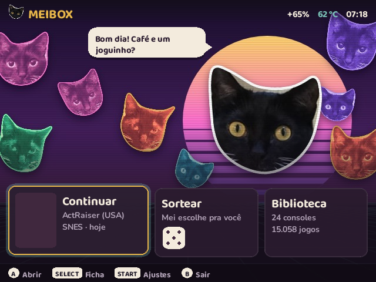
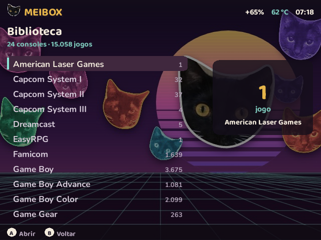
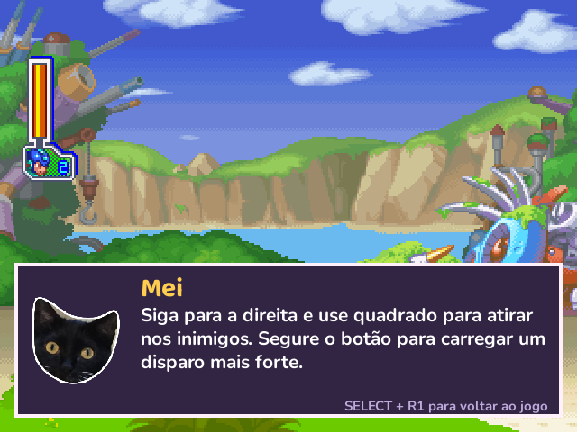
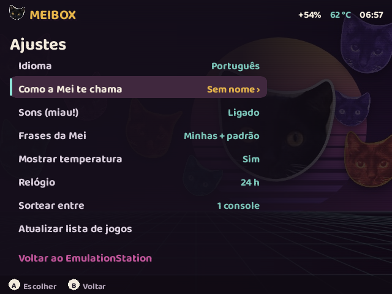
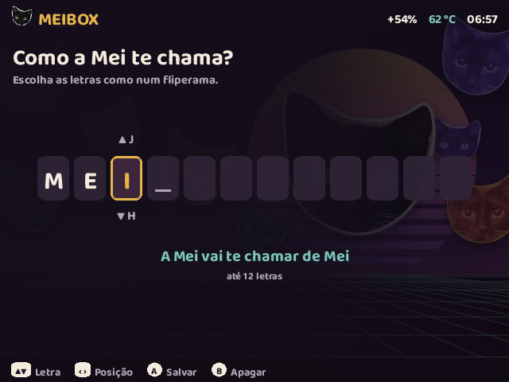
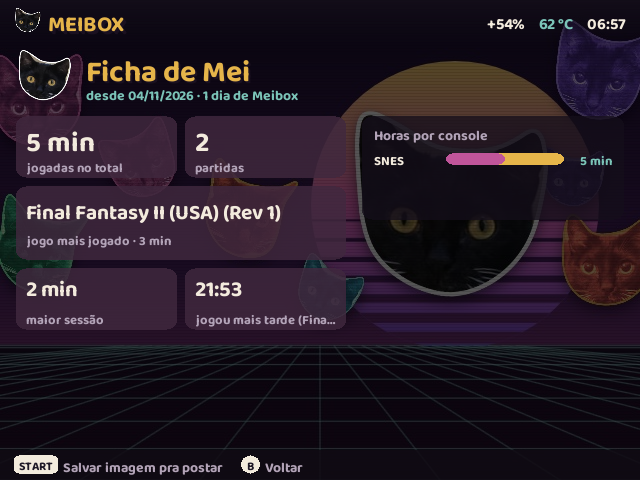

# Meibox

*[Read in English](README.en.md)*

Uma tela inicial aconchegante e uma ajudante de IA dentro do jogo para o portátil **R36S** (e clones com ArkOS / dArkOS). A estrela é a **Mei**, uma gata preta e branca de verdade.

As partes principais são dois programas, que funcionam sozinhos ou juntos. O instalador também deixa os seus jogos **[mais rápidos](#jogos-mais-rápidos)**, e há uma ferramenta de diagnóstico [abaixo](#mais-neste-repositório).

| Pasta | O que é |
|---|---|
| [`meibox/`](meibox/) | **Meibox**, uma interface para abrir os jogos, que aparece antes do EmulationStation. Tem tela inicial com "continuar", sorteio feito pela Mei, biblioteca rápida, a sua ficha de jogo e ajustes em português ou inglês. |
| [`copiloto/`](copiloto/) | **Copiloto da Mei**, dicas dentro do jogo. Aperte **SELECT + R1** em qualquer jogo do RetroArch: o jogo pausa e o balão da Mei diz o que fazer agora, olhando a tela. Aperte de novo para voltar a jogar. |

  
  
  
  
  
  

## Jogos mais rápidos

O instalador pergunta se pode deixar os jogos mais rápidos (recomendado). Por trás disso há dois dias de medições num R36S: cada jogo foi medido a partir da mesma cena pesada, antes e depois de cada mudança, e cada mudança tem como ser desfeita.

- **Nenhum jogo engasgando:** dos 27 jogos mais pesados medidos, os que não seguravam 60 fps caíram de **5 para 0**.
- **SNES:** em média **24% mais rápido**. Star Fox foi de 63 para 96 fps, e Doom, de 58 para 79.
- **GBA:** de 11% a 16% mais rápido em qualquer jogo, e de **55% a 280%** nos 3D pesados. F-Zero GP Legend foi de 70 para 268 fps.
- **Botão mais rápido:** quase todos os jogos de SNES, GBA e Mega Drive respondem **um quadro antes** (~16 ms).

Como isso foi feito:
- **Emuladores recompilados:** snes9x, mGBA e gpSP foram compilados para o processador do R36S. No snes9x e no mGBA, a compilação foi guiada por um perfil gravado jogando no próprio aparelho.
- **Vídeo jogo por jogo:** os jogos leves rodam sem o atraso extra de vídeo, e os pesados ganham folga.
- **Emulador certo para cada jogo:** os que pedem usam outro emulador, como o Star Fox e os outros jogos com Super FX, o Doom e os 3D de GBA.

O instalador reconhece os jogos pelo conteúdo da ROM, não pelo nome do arquivo, então funciona com a sua coleção, inclusive traduções. Se um emulador novo não abrir no seu sistema, o original fica. Remover volta tudo ao original. O método e todos os números estão no [relatório](desempenho/results/RELATORIO-FINAL.md).

## O que precisa

- Um R36S ou parecido com **dArkOS** ou **ArkOS**. Testado no dArkOSRE.
- Não funciona em ROCKNIX, AmberELEC nem Knulli, que são montados de outro jeito.
- Para o copiloto, que é opcional:
  - um adaptador Wi-Fi USB, porque o R36S não tem Wi-Fi;
  - uma chave de API da OpenAI ou da Anthropic.

## Instalar

Não precisa de Wi-Fi, terminal nem computador ligado ao aparelho: só do cartão SD.

1. Baixe o `Meibox-<versão>.zip` na página de [Releases](https://github.com/carbiecarbie/meibox/releases) e descompacte.
2. Desligue o aparelho, tire o cartão SD do sistema e ponha no computador. Abra a unidade **EASYROMS** (onde ficam os jogos).
3. Copie as pastas `tools` e `totobox` do ZIP para dentro do EASYROMS. Se o computador perguntar, diga que quer juntar ou substituir.
4. *(Opcional, para o copiloto)* abra `EASYROMS/totobox/chave-da-ia.txt`, cole a sua chave na linha em branco e salve.
5. Devolva o cartão, ligue o aparelho e abra **Options › Tools › Instalar Meibox**. Siga a tela. No fim ele reinicia, e o Meibox abre.

- **Atualizar:** copie as pastas da versão nova por cima e rode o mesmo item.
- **Remover:** rode o mesmo item e escolha Remover.
- **Pular o Meibox numa vez:** segure **B** enquanto o aparelho liga.

**Quer que uma IA faça tudo?** Se você usa um assistente que mexe no computador (Claude Code, Codex e parecidos), conecte o aparelho no Wi-Fi e peça para ele ler o `PARA-SUA-IA.md` do ZIP. Ele instala pela rede, explica cada passo e nunca vê a sua chave.

Prefere o terminal, quer outra IA ou vai mexer no código? Veja a [instalação manual e as opções avançadas](docs/instalacao-manual.md).

## Usar o Meibox

- **Tela inicial:** esquerda/direita e A escolhem o cartão, START abre os Ajustes, SELECT abre a sua Ficha e B volta ao EmulationStation.
- **Ajustes › Como a Mei te chama:** escolha até 12 letras, como num fliperama. Cima/baixo trocam a letra, esquerda/direita mudam a posição, A salva e B apaga. A Mei e o copiloto passam a usar esse nome.
- **Frases suas:** escreva frases para a Mei em `totobox/frases-pt.txt` (ou `frases-en.txt`) no cartão. O próprio arquivo explica o formato.
- **Imagem da Ficha:** START na Ficha salva uma imagem para postar, em `totobox/fichas/`. Para pôr um rodapé nela, como o seu site, escreva-o na primeira linha de `totobox/rodape-ficha.txt`.

## Copiloto da Mei

Num jogo do RetroArch, aperte **SELECT + R1**. O jogo pausa, a foto da tela vai para a IA que você escolheu, e a Mei responde num balão por cima do jogo.

- **Ficha do jogo:** na primeira vez que você pede ajuda num jogo, a Mei **pesquisa o jogo na internet**. Isso leva cerca de 1 minuto, e a tela mostra "Mei está estudando…". Ela escreve uma ficha em `totobox/guias/<Console>/<Jogo>.txt` com:
  - os controles daquela versão;
  - as fases;
  - as 5 partes onde mais se trava;
  - os chefes;
  - os itens que se perdem;
  - os segredos.

  Todas as dicas seguintes usam essa ficha. Você pode ler e corrigir pelo PC, ou apagar para ela refazer.
- **Diário:** um registro curto por jogo, para a Mei não repetir a mesma dica.
- **Dicas salvas:** cada dica também vira uma imagem (tela do jogo + balão) em `totobox/dicas/`, pronta para postar.
- **Limites:** 200 dicas e 10 fichas por dia. Dica que falha não conta.
- **Idioma e nome:** seguem os Ajustes do Meibox.
- **Qual IA:** o instalador vê pela chave se ela é da OpenAI ou da Anthropic e escolhe o modelo. Na OpenAI é o `gpt-6.1-terra`, que o autor usa e que deu as melhores dicas nos testes. Na Anthropic são o Claude Haiku para as dicas e o Sonnet para as fichas. Para usar OpenRouter, Gemini ou uma IA rodando em casa, veja as [opções avançadas](docs/instalacao-manual.md#chave-e-modelo-à-mão).

### Custo, velocidade e impacto (medidos num R36S)

- **Velocidade e custo da dica:**
  - com o `gpt-6.1-terra`, leva ~2,5 a 4 s do botão ao balão e custa ~US$ 0,003;
  - com o Claude Haiku 5.5, leva ~2 s e custa ~US$ 0,0005.
- **Custo da ficha**, **uma vez por jogo**, com busca na web:
  - ~US$ 0,06 a 0,08 com o Terra;
  - US$ 0,2 a 0,3 com o Claude Sonnet.
- **Memória:** ~30 MB parado. Com o Claude, ~90 MB depois da primeira dica.
- **Fps:** não muda. O serviço não faz nada enquanto você joga. Com o copiloto desligado e ligado:
  - Super Mario RPG: 76,6 e 76,0 fps;
  - Doom (SNES): 79,1 e 79,4 fps.

  As diferenças ficam dentro do ruído da medição.
- **Privacidade:** para a IA vão só a foto da tela, o nome do jogo e do console, o nome que você escolheu, e a ficha e o diário daquele jogo. A chave fica guardada no aparelho com acesso restrito, nunca no cartão.

## O que a instalação muda no aparelho

**Meibox:**
- instala o app em `~/.local/share/totobox`;
- cria a entrada Options › Meibox;
- se você quiser, faz o Meibox abrir ao ligar, antes do EmulationStation.

**Copiloto:**
- instala o app em `~/.local/share/mei-copiloto` e a config em `~/.config/mei-copiloto`;
- cria o serviço `mei-copiloto`, que só escuta dentro do aparelho (`127.0.0.1:4404`);
- cria uma regra de rede que fecha a porta UDP 55355 para fora do aparelho;
- nas duas configs do RetroArch, troca 6 linhas para o SELECT + R1 chamar a Mei, depois de guardar um backup em `retroarch.cfg.antes-copiloto`. Se o R1 já estiver em uso, ele não mexe nessas configs.

**Jogos mais rápidos** (se você aceitar):
- troca snes9x, mGBA e gpSP pelas versões recompiladas e guarda os originais em `~/.local/share/meibox-desempenho/originais`;
- cria ajustes do RetroArch por emulador e por jogo, marcados como do Meibox. Se já existir um ajuste seu, ele não é tocado;
- nos jogos que pedem outro emulador, marca isso na lista de jogos do EmulationStation, com backup em `gamelist.xml.antes-meibox-desempenho`. Essa marcação é feita no próximo início, por um passo que roda antes do EmulationStation.

**Remover desfaz tudo isso:**
- volta os emuladores originais (se você não tiver trocado por outros), apaga os ajustes que ele criou e tira a marcação dos jogos;
- volta as 6 linhas do RetroArch;
- tira os serviços e a regra de rede;
- apaga os apps.

O que fica:
- as suas fotos da Ficha, frases, dicas e fichas de jogo, na pasta `totobox` do cartão;
- a chave, a menos que você peça para apagar.

## Mais neste repositório

| Pasta | O que é |
|---|---|
| [`desempenho/`](desempenho/) | **Otimização de desempenho** de um R36S com dArkOSRE para SNES, Mega Drive e GBA. Cada mudança foi medida no aparelho e tem como ser desfeita com `device/undo-all.sh`. Tem testes de fps a partir de savestates, cores recompilados com `-O3`/PGO e ajustes do RetroArch por núcleo e por jogo. Dos 27 jogos mais pesados medidos, os que ficavam abaixo de 60 fps caíram de 5 para 0. O relatório está em [`desempenho/results/RELATORIO-FINAL.md`](desempenho/results/RELATORIO-FINAL.md). O instalador aplica a parte dos emuladores e dos ajustes por jogo. O código-fonte exato dos emuladores vai em cada [release](https://github.com/carbiecarbie/meibox/releases). |
| [`instalador/`](instalador/) | O **instalador pelo cartão SD** que gera o ZIP da release: o item no menu Options › Tools, o cuidado com a chave e o `PARA-SUA-IA.md`. |
| [`diagnostico/`](diagnostico/) | **R36S Diagnostics**, uma ferramenta pequena em menus de texto, aberta pelo menu Options do EmulationStation. Mostra rede, USB, CPU, memória, bateria e espaço, e salva um relatório JSON/TXT. Veja [`diagnostico/README.txt`](diagnostico/README.txt). |

## Créditos

- A **Mei** é a gata do autor. Todas as fotos são dela.
- Fontes: [Baloo 2](https://fonts.google.com/specimen/Baloo+2) e [Nunito](https://fonts.google.com/specimen/Nunito), licença SIL Open Font 1.1.
- Os sons da interface são gerados pelo próprio código; não há áudio de terceiros.

## Licença

[MIT](LICENSE). As fontes mantêm a licença OFL delas.

Os emuladores recompilados não são código do Meibox e mantêm as licenças deles:
- Snes9x: licença própria, uso e distribuição gratuitos sem fins comerciais;
- mGBA: MPL 2.0;
- gpSP: GPL 2.

Os textos das licenças vão no ZIP, em `totobox/instalador/desempenho/licencas/`. O código-fonte exato de cada um, com os scripts de compilação, está na página de cada release, no arquivo `Meibox-<versão>-fontes-dos-emuladores.zip`.
