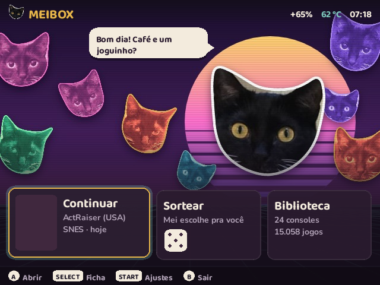
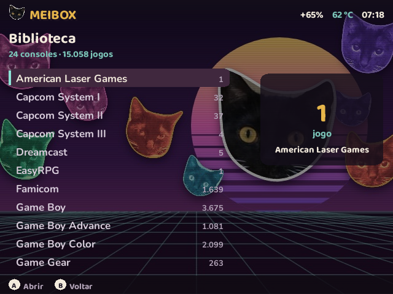
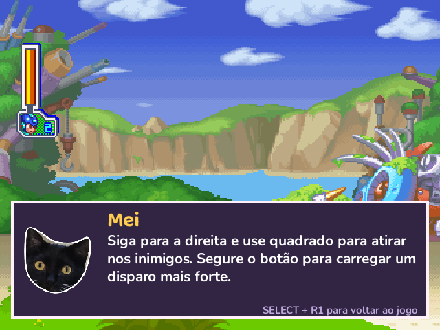
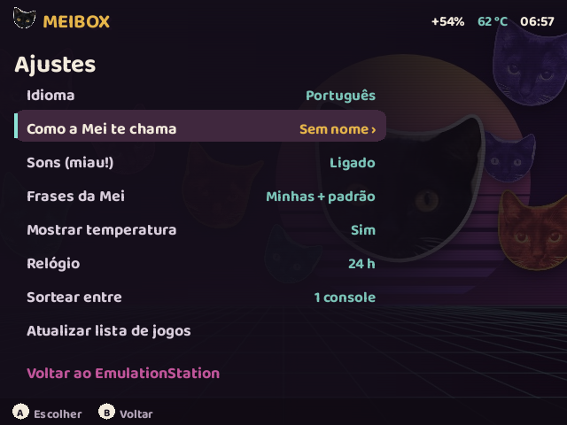
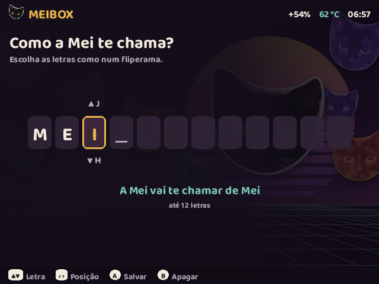
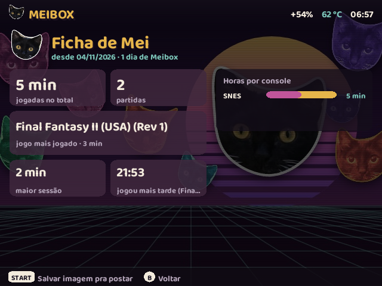

# Meibox

*[Read in English](README.md)*

Uma tela inicial aconchegante e uma ajudante de IA dentro do jogo para o portátil **R36S** (e clones com ArkOS / dArkOS). A estrela é a **Mei**, uma gata preta e branca de verdade.

As partes principais são dois programas, que funcionam sozinhos ou juntos (e mais a otimização de desempenho e uma ferramenta de diagnóstico, [abaixo](#mais-neste-repositório)):

| Pasta | O que é |
|---|---|
| [`meibox/`](meibox/) | **Meibox**, uma interface para abrir os jogos, que aparece antes do EmulationStation. Tem tela inicial com "continuar", sorteio feito pela Mei, biblioteca rápida, a sua ficha de jogo e ajustes em português ou inglês. |
| [`copiloto/`](copiloto/) | **Copiloto da Mei**, dicas dentro do jogo. Aperte **SELECT + R1** em qualquer jogo do RetroArch: o jogo pausa e o balão da Mei diz o que fazer agora, olhando a tela. Aperte de novo para voltar a jogar. |

<p>
  
  
  
  
  
  
</p>

## O que precisa

- Um R36S (RK3326) ou parecido com **dArkOS / ArkOS**. Testado no dArkOSRE (Debian 13, Python 3.13, RetroArch 1.22.2).
- As bibliotecas SDL2, SDL2_image e SDL2_ttf. Elas já vêm nesses sistemas.
- Para o copiloto: Wi-Fi com internet e uma chave de API de um serviço de IA (veja [Escolher a IA](#escolher-a-ia)).
- Acesso SSH ao aparelho para instalar, por exemplo com "Enable Remote Services".

## Meibox

### Instalar

Copie a pasta `meibox/` para o aparelho, por exemplo para `/tmp/meibox`, e rode com o seu usuário normal (`ark`):

```bash
bash /tmp/meibox/device/install.sh --boot
```

O que a instalação faz:
- instala o app em `~/.local/share/totobox` (o nome interno ainda é *totobox*);
- põe o **Meibox** no menu *Options* do EmulationStation;
- com `--boot`, também abre o Meibox ao ligar o aparelho. Quando você sai do Meibox, o EmulationStation abre normalmente.

Para pular o Meibox no boot:
- segure **B** enquanto o aparelho liga;
- ou crie o arquivo `/roms/totobox/nao-abrir-ao-ligar`.

Opcional: `meibox/assets/meibox/loading-meibox.jpg` pode substituir `/roms/launchimages/loading.jpg` como imagem de carregamento dos jogos.

### Usar

- **Tela inicial:** esquerda/direita e A escolhem o cartão, START abre os Ajustes, SELECT abre a sua Ficha e B volta ao EmulationStation.
- **Ajustes › Como a Mei te chama:** escolha até 12 letras, como num fliperama. Cima/baixo trocam a letra, esquerda/direita mudam a posição, A salva e B apaga. A Mei e o copiloto passam a usar esse nome.
- **Frases suas:** escreva frases para a Mei em `/roms/totobox/frases-pt.txt` (ou `frases-en.txt`). O próprio arquivo explica o formato.
- **Imagem da Ficha:** START na Ficha salva uma imagem para postar, em `/roms/totobox/fichas/`. Para pôr um rodapé nela, como o seu site, escreva-o na primeira linha de `/roms/totobox/rodape-ficha.txt`.

### Desinstalar

```bash
bash ~/.local/share/totobox/device/uninstall.sh
```

As suas frases e imagens em `/roms/totobox` ficam.

## Copiloto da Mei (dicas no jogo)

O RetroArch tem um **Serviço de IA** próprio. Quando você aperta o atalho, ele pausa o jogo e manda a foto da tela para um endereço. O copiloto é um pequeno serviço em Python em `127.0.0.1:4404`. Ele manda para o serviço de IA que você escolheu:
- a foto da tela;
- o console e o nome do jogo;
- a ficha do jogo, quando existe;
- as últimas dicas.

Depois desenha o balão da Mei como um PNG transparente, e o RetroArch mostra esse balão por cima do jogo pausado.

- **Ficha do jogo:** na primeira vez que você pede ajuda num jogo, a Mei **pesquisa o jogo na internet** (cerca de 1 minuto; o RetroArch mostra "Mei está estudando…"). Ela escreve uma ficha em texto em `/roms/totobox/guias/<Console>/<Jogo>.txt` com:
  - os controles daquela versão;
  - as fases;
  - as 5 partes onde mais se trava;
  - os chefes;
  - os itens que se perdem;
  - os segredos.

  Todas as dicas seguintes usam a ficha. Você pode ler e corrigir pelo PC, ou apagar para ela refazer.
- **Diário:** um registro curto por jogo, para a Mei não repetir a mesma dica.
- **Dicas salvas:** cada dica também vira uma imagem (tela do jogo + balão) em `/roms/totobox/dicas/`, pronta para postar.
- **Limites:** 200 dicas e 10 fichas por dia, de padrão. Dica que falha não conta.
- **Idioma e nome:** seguem os Ajustes do Meibox, se ele estiver instalado. Sem o Meibox, fica em português; para inglês, ponha `"idioma": "en"` na config.

### Instalar

Copie a pasta `copiloto/` para o aparelho, por exemplo para `/tmp/copiloto`. Primeiro veja o que ela mudaria, depois instale:

```bash
bash /tmp/copiloto/device/install.sh --conferir
```

```bash
bash /tmp/copiloto/device/install.sh
```

O que muda:
1. Instala o app em `~/.local/share/mei-copiloto` e a config em `~/.config/mei-copiloto/config.json`. Uma config que já existe nunca é sobrescrita.
2. Cria `/roms/totobox/dicas` e `/roms/totobox/guias`.
3. Cria uma **regra nft** (serviço `mei-copiloto-porta`) que fecha a porta UDP 55355 para a rede. Os comandos de rede do RetroArch, que mostram o aviso "estudando", escutariam em todas as interfaces. Para pular, use `--sem-porta`.
4. Cria o **serviço `mei-copiloto`**, que liga no boot.
5. Nas **duas** configs do RetroArch (`retroarch` e `retroarch32`), faz backup em `retroarch.cfg.antes-copiloto` e troca 6 linhas: `ai_service_enable`, `ai_service_url`, `ai_service_mode`, `ai_service_pause`, `input_ai_service_btn = "5"` (R1) e `network_cmd_enable`. Para pular, use `--sem-retroarch`. A instalação recusa rodar com um jogo aberto e não grava nada se algum atalho ou override de núcleo já usar o R1.

`--com-sdk` instala também o SDK da Anthropic em Python (cerca de 47 MB). Ele só é necessário para o Claude.

### Escolher a IA

**Nenhuma IA vem configurada.** Até você escolher uma, o balão avisa isso. Você precisa:
1. pôr a sua chave no aparelho, e
2. escolher o fornecedor e o modelo na config.

**1. A chave.** Rode este comando no seu computador. Ele pede a chave sem mostrar na tela, grava com permissão 600 e nunca a registra no log:

```bash
ssh -t ark@<ip-do-aparelho> 'umask 077; mkdir -p ~/.config/mei-copiloto/chaves && read -rsp Chave: K && printf %s "$K" > ~/.config/mei-copiloto/chaves/openai && unset K && echo && echo ok'
```

Use `chaves/openai` para a OpenAI ou qualquer serviço compatível, e `chaves/anthropic` para o Claude.

**2. A config.** Edite `~/.config/mei-copiloto/config.json` e preencha `dicas` e `ficha`:

OpenAI. É o que o autor usa: dicas melhores nos testes e nenhum SDK extra.
```json
"dicas": {"fornecedor": "openai_compat", "modelo": "gpt-6.1-terra", "esforco": "low"},
"ficha": {"fornecedor": "openai_compat", "modelo": "gpt-6.1-terra", "esforco": "medium", "busca_web": true, "max_buscas": 5},
```

Claude. Instale com `--com-sdk`.
```json
"dicas": {"fornecedor": "anthropic", "modelo": "claude-haiku-5-5", "esforco": "low"},
"ficha": {"fornecedor": "anthropic", "modelo": "claude-sonnet-5-5", "esforco": "medium", "busca_web": true, "max_buscas": 5},
```

Outros serviços compatíveis com a OpenAI (OpenRouter, o endereço compatível do Gemini, um servidor local Ollama ou llama.cpp):
- ajuste `fornecedores.openai_compat.url` e escolha um modelo que aceite imagem;
- a busca na web só funciona na `api.openai.com`, então nos outros serviços a ficha sai com o que o modelo já sabe, marcada "feita sem pesquisa".

Depois reinicie o serviço:

```bash
sudo systemctl restart mei-copiloto
```

### Custo, velocidade e impacto (medidos num R36S)

- **Velocidade:** com o `gpt-6.1-terra`, uma dica leva ~2,5 a 4 s do botão ao balão e custa ~US$ 0,003. Com o Claude Haiku 5.5, leva ~2 s e custa ~US$ 0,0005.
- **Custo da ficha:** com busca na web, ~US$ 0,06 a 0,08 com o Terra ou US$ 0,2 a 0,3 com o Claude Sonnet, **uma vez por jogo**.
- **Memória:** ~30 MB parado. Com o SDK da Anthropic, ~90 MB depois da primeira dica.
- **Fps:** não muda. Super Mario RPG ficou em 76,6 contra 76,0 fps e Doom (SNES) em 79,1 contra 79,4, com o copiloto desligado e ligado, dentro do ruído da medição. O serviço não faz nada enquanto você joga.
- **Privacidade:** só vão para o serviço de IA a foto da tela, o nome do jogo e do console, o seu nome escolhido e a ficha e o diário daquele jogo. O serviço só escuta em `127.0.0.1`.

### Desinstalar

```bash
bash ~/.local/share/mei-copiloto/device/uninstall.sh
```

O que ela faz:
- volta só aquelas 6 linhas do RetroArch, a partir do backup;
- tira os dois serviços e a regra nft;
- apaga o app.

Ficam as suas chaves, a config, as dicas e as fichas.

### Desenvolvimento

Os testes rodam no PC, sem SDL e sem rede:

```bash
cd copiloto && python -m unittest discover -s tests
```

```bash
cd meibox && python -m unittest discover -s tests
```

`copiloto/scripts/deploy.py` copia o copiloto para o `/tmp` de um aparelho: `R36S_HOST=ark@<ip> python scripts/deploy.py`.

## Mais neste repositório

| Pasta | O que é |
|---|---|
| [`desempenho/`](desempenho/) | **Otimização de desempenho** de um R36S com dArkOSRE para SNES, Mega Drive e GBA. Cada mudança foi medida no aparelho e tem como ser desfeita com `device/undo-all.sh`. Tem testes de fps a partir de savestates, cores recompilados com `-O3`/PGO e ajustes do RetroArch por núcleo e por jogo. Dos 27 jogos mais pesados medidos, os que ficavam abaixo de 60 fps caíram de 5 para 0. O relatório está em [`desempenho/results/RELATORIO-FINAL.md`](desempenho/results/RELATORIO-FINAL.md). O código-fonte dos cores de terceiros e o backup do `/boot` não vêm junto. |
| [`diagnostico/`](diagnostico/) | **R36S Diagnostics**, uma ferramenta pequena em menus de texto, aberta pelo menu Options do EmulationStation. Mostra rede, USB, CPU, memória, bateria e espaço, e salva um relatório JSON/TXT. Veja [`diagnostico/README.txt`](diagnostico/README.txt). |

## Créditos

- A **Mei** é a gata do autor. Todas as fotos são dela.
- Fontes: [Baloo 2](https://fonts.google.com/specimen/Baloo+2) e [Nunito](https://fonts.google.com/specimen/Nunito), licença SIL Open Font 1.1.
- Os sons da interface são gerados pelo próprio código; não há áudio de terceiros.

## Licença

[MIT](LICENSE). As fontes mantêm a licença OFL delas.
